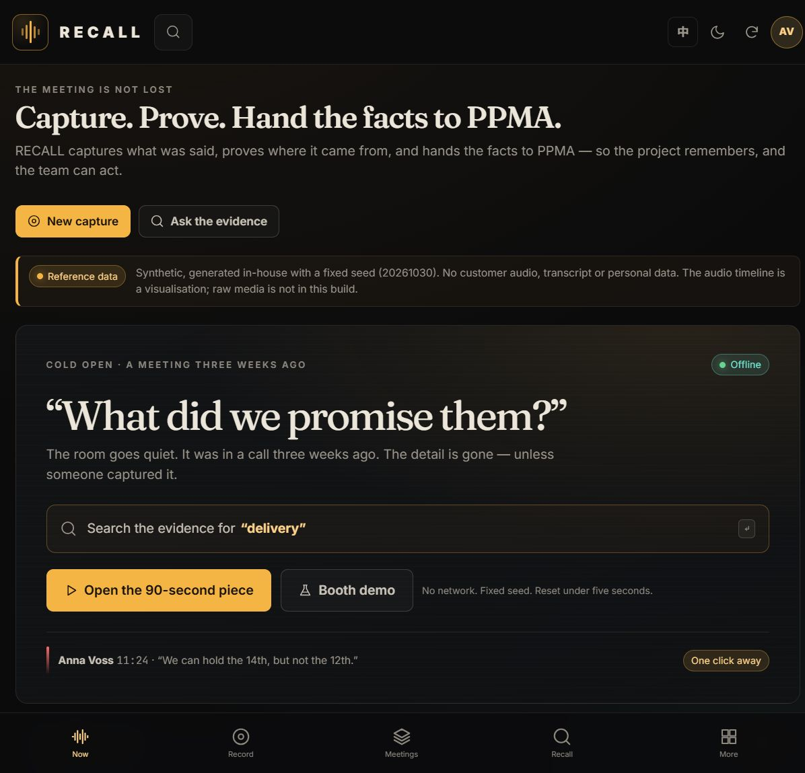
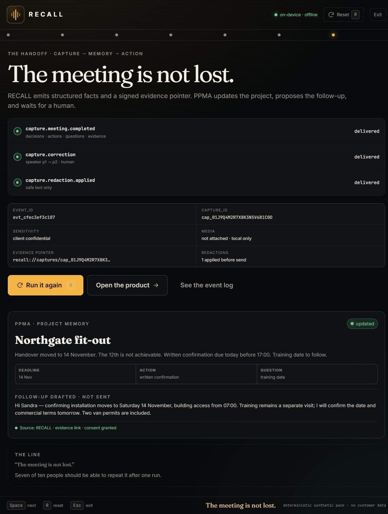
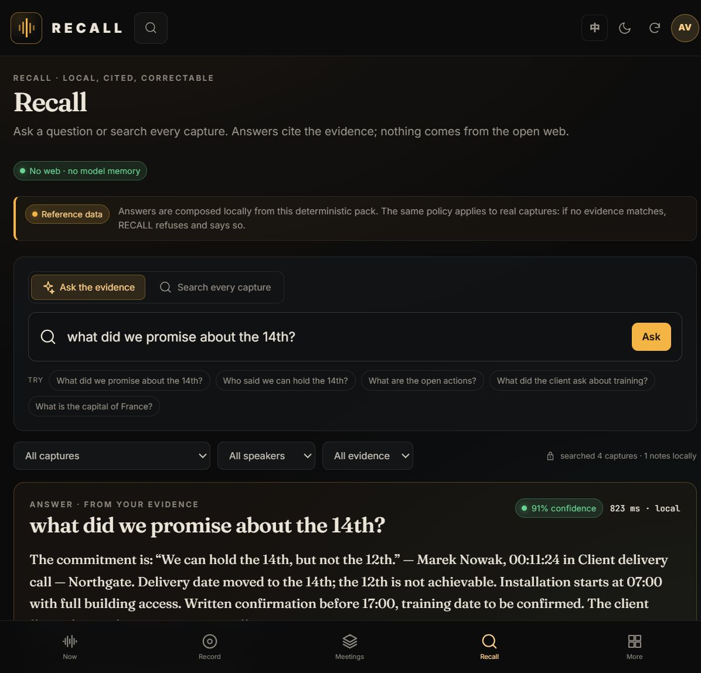
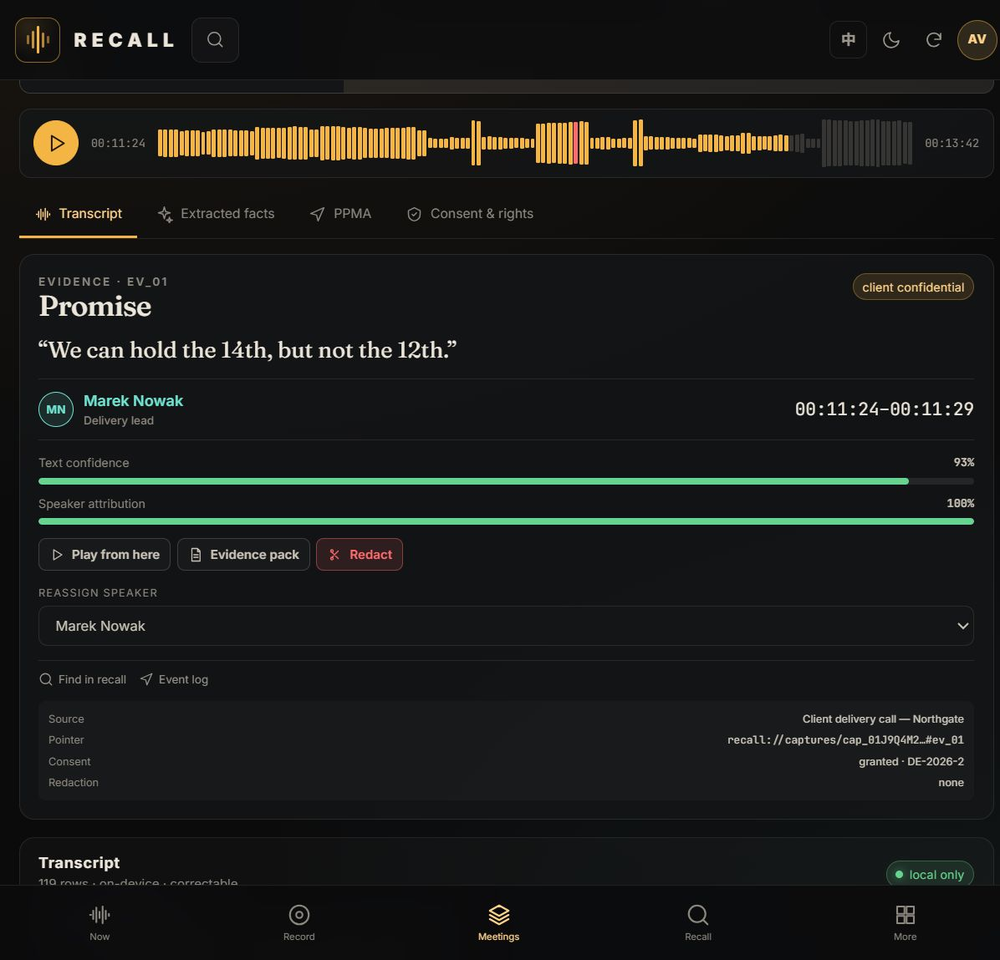
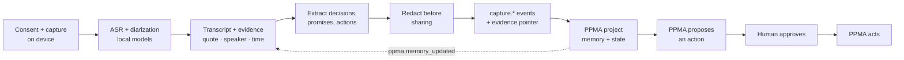

# RECALL

**Capture what was said, prove where it came from, and hand the facts to PPMA — so the project remembers, and the team can act.**

[**Play the 90-second recall →**](https://jiuwendemos.github.io/recall/#/stage) · [**Open the functional demo →**](https://jiuwendemos.github.io/recall/#/booth) · [**Ask the evidence →**](https://jiuwendemos.github.io/recall/#/recall)

[](https://github.com/jiuwendemos/recall/actions/workflows/ci.yml)
[](https://github.com/jiuwendemos/recall/actions/workflows/pages.yml)



| The 90-second piece | Ask the evidence |
| --- | --- |
|  |  |



> *“The meeting is not lost.”*

RECALL is the private capture layer for a PPMA project. It records meetings, calls and field notes,
transcribes and diarizes on-device, extracts decisions, promises and actions, keeps the exact quote with
speaker, timestamp, confidence and source, redacts sensitive passages before sharing, and emits structured
facts to PPMA. Raw audio and video stay local by default.

The public site is a **static, offline build** of the product UI, driven by a deterministic synthetic
pack. No customer audio, transcript or personal data is included. There is no network call after load.

---

## The 90-second stage piece

A meeting room. A phone on the table. The client asks: *“What did we promise them?”*

1. **Cold open** — the promise is lost in a call three weeks ago.
2. **Capture** — tap record; the transcript appears on-device.
3. **Recall** — search “delivery”; the exact quote, speaker and timestamp appear.
4. **Trust beat** — RECALL attributes the promise to the wrong speaker. The human corrects it; a
   `capture.correction` event updates the PPMA memory in the same scene.
5. **Audience choice** — share the clip, or redact the internal comment first. The room decides.
6. **Handoff** — PPMA moves the deadline, creates an action and drafts the follow-up.

**The line.** *“The meeting is not lost.”* Reset is one key, under five seconds.

---

## What is in this repository

| Surface | What it is | Route |
|---|---|---|
| **Stage piece** | Deterministic 90-second arc: record, recall, correct, redact, hand off. | [`/#/stage`](https://jiuwendemos.github.io/recall/#/stage) |
| **Booth demo** | A three-minute guided run with the whole data trail exposed. | [`/#/booth`](https://jiuwendemos.github.io/recall/#/booth) |
| **Now** | Recent captures, open promises, PPMA project state, consent coverage. | [`/#/`](https://jiuwendemos.github.io/recall/#/) |
| **Record** | Consent before capture, device state, live transcript, local model run, audio import. | [`/#/record`](https://jiuwendemos.github.io/recall/#/record) |
| **Meetings** | Every capture, status, consent, speakers, evidence, redactions and tombstones. | [`/#/meetings`](https://jiuwendemos.github.io/recall/#/meetings) |
| **Meeting workspace** | Transcript editing, speaker correction, extracted facts, redaction, evidence packs, retention, deletion and PPMA events. | [`/#/meetings/mtg_delivery_1030`](https://jiuwendemos.github.io/recall/#/meetings/mtg_delivery_1030) |
| **Recall** | Search every capture or ask a question. Answers are restricted to local evidence, with citations and an inspectable trace. | [`/#/recall`](https://jiuwendemos.github.io/recall/#/recall) |
| **PPMA north app** | Manifest, event log, local PPMA inbox, commands, conformance, credentials and queue. | [`/#/ppma`](https://jiuwendemos.github.io/recall/#/ppma) |
| **Field capture** | Offline-first notes, photo OCR, low-power mode, do-not-record zones and sync. | [`/#/field`](https://jiuwendemos.github.io/recall/#/field) |
| **Pilot dashboard** | The six gates, latency, useful extraction, funnel, baselines and the honest read. | [`/#/pilot`](https://jiuwendemos.github.io/recall/#/pilot) |
| **Admin** | Spaces, roles, devices, SSO, residency, compliance, billing, audit and the kill switch. | [`/#/admin`](https://jiuwendemos.github.io/recall/#/admin) |
| **Capture health** | Model cards, drift, device health, queue depth, memory hygiene and the privacy runbook. | [`/#/health`](https://jiuwendemos.github.io/recall/#/health) |
| **Design system** | Tokens, type, record control, waveform, transcript, evidence, redaction, motion, glossary and accessibility. | [`/#/design`](https://jiuwendemos.github.io/recall/#/design) |
| **About** | The boundary with PPMA, the eight task families, NPU usage, business model and hard parts. | [`/#/about`](https://jiuwendemos.github.io/recall/#/about) |

The admin surface is visible when the role selector is set to **Privacy / legal** or **Admin**. The nav
deliberately hides what a role cannot act on.

---

## The boundary that keeps RECALL and PPMA complementary

| Job | RECALL | PPMA |
|---|---|---|
| Capture audio / video / notes | **Owns** | Never |
| Transcribe, diarize, summarize | **Owns** | Consumes |
| Consent, redaction, media retention | **Owns** | Respects |
| Living project memory and state | Never | **Owns** |
| Tasks, calendar, email, missions | Never | **Owns** |
| Proactive action | Never | **Owns** |
| Evidence pack for a quote | **Owns** | Links to it |
| “What should happen next?” | Never | **Owns** |

RECALL never creates a task, schedules a meeting, sends a message or runs a mission. PPMA never records
or stores raw media. The contract is in [`docs/integration-ppma.md`](docs/integration-ppma.md).

---

## Run it locally

Requirements: Node 20+ (tested on Node 24), npm 10+.

```bash
cd web
npm install
npm run dev        # http://localhost:5184
npm test           # 12 contract and recall tests
npm run build      # type-check + static build in web/dist
```

The demo pack is generated deterministically from the script:

```bash
py scripts/build_demo_pack.py      # Windows
python3 scripts/build_demo_pack.py # macOS / Linux / CI
```

The pack is committed at `web/public/demo-pack.json`, so the site works offline and on a USB stick.
Deployment is GitHub Pages via `.github/workflows/pages.yml`.

---

## Architecture in one minute



All state lives in the browser for the demo, with `localStorage` persistence, a consent gate in the
store, an offline queue, idempotent event delivery and a local PPMA fake that applies corrections,
redactions, consent withdrawal and tombstones. See [`docs/architecture.md`](docs/architecture.md).

---

## What is real and what is simulated

**Real in this build:** the 90-second stage state machine, consent gating, transcript editing, speaker
correction, redaction with safe-version preview, evidence packs with hashes, retention and legal hold
controls, deletion tombstones, PPMA event envelopes, idempotency/duplicate detection, offline queue,
audit export, role-based navigation, English/Chinese UI, dark/paper/high-contrast themes, offline PWA
shell, deterministic tests and a fully static deployment.

**Simulated for the public demo:** the scripted 14-minute meeting and its 119 transcript rows, the local
ASR/diarization outputs, the on-device OCR result, the PPMA backend, pilot metrics and admin/billing
data. The microphone is not opened, and the audio timeline is a visualisation — no audio is included.
Production swap points (real NPU runtime, encrypted SQLite store, OIDC, sync, billing) are named in
[`docs/architecture.md`](docs/architecture.md).

**Never:** training on customer audio or transcripts, raw media in the cloud by default, silent
deletion, or capture without a recorded consent state.

---

## Tests

`web/src/lib/engine.test.ts` covers the promises that keep the product trustworthy:

- the promise is the top result for “delivery”;
- an answer cites evidence and refuses when there is none;
- a deleted memory is not answered from;
- no event is emitted without consent;
- speaker correction updates the transcript and attribution;
- redaction swaps the safe text and never sends the raw internal comment;
- deletion leaves a tombstone and removes the transcript;
- event ids are stable and duplicates are rejected;
- an evidence pack contains speaker, timestamp, source, consent and a hash.

```bash
cd web && npm test
```

The CI also regenerates the pack and fails if the committed pack is not reproducible.

---

## Data rights and provenance

- Synthetic pack, fixed seed `20261030`. No customer audio, transcript or personal data.
- Fonts (Fraunces, Inter, JetBrains Mono) are bundled locally. No font, icon or CDN calls.
- Icons are in-house SVG.
- The service worker and all assets are relative, so the build works under `/recall/` or from a folder.
- Licence: MIT. See [`LICENSE`](LICENSE) and [`docs/provenance.md`](docs/provenance.md).

---

## Documentation

- [Concept](docs/concept.md) — what RECALL is, what it is not, the buyer, the business model.
- [Roadmap](docs/roadmap.md) — 0A through Phase 6, every checkbox implemented in this demo.
- [PPMA × RECALL contract](docs/integration-ppma.md) — events, commands, consent, deletion, idempotency.
- [Architecture](docs/architecture.md) — state machine, store, event pipeline, security, production swaps.
- [Stage script](docs/stage-script.md) — the 90 seconds, props, reset, fallback and rehearsals.
- [Design audit & research](docs/design-audit.md) — responsive audit, WCAG, budgets and the pilot research gate.
- [Safe evidence API](docs/evidence-api.md) — public evidence-pack contract.
- [Provenance](docs/provenance.md) — assets, synthetic data, reproducibility and the public-demo boundary.

---

**The meeting is not lost.**
